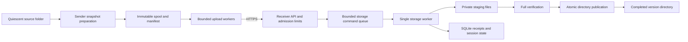

# ShardSync — resumable file transfer in Rust

**Technical design, version 1.1 · 31 October 2026 · Design only**

## 1. Purpose and user

ShardSync transfers a fixed version of a large file or folder from one computer to another. Its intended user is a developer moving datasets, generated reports, model artifacts, or build outputs over an unreliable connection. After a disconnect or process restart, the sender asks which chunks the receiver still needs and continues that transfer.

The final demonstration is concrete: interrupt a large transfer, restart both processes, resume, and prove that the published output exactly matches the prepared input. Display how many bytes were resent, peak memory, and time spent transferring and verifying.

This is a file-transfer tool, not continuous folder synchronization. It does not merge edits, delete existing destination files, replicate databases, or infer which of two modified folders is authoritative. Syncthing provides an established reference for block hashes, checking received blocks, and preparing output before exposing it; ShardSync deliberately uses a much smaller protocol. [Source: Syncthing synchronization design](https://docs.syncthing.net/users/syncing.html).

## 2. Scope and guarantees

The first milestone handles one regular file. The completed first release also handles a directory containing regular files and directories, using the same transfer protocol. One receiver supports one active transfer at a time; it can retain multiple completed versions. Multiple sender uploads within that transfer provide bounded concurrency.

Version 1 supports Linux on a tested local filesystem such as ext4. macOS can be a development environment; publication and durability claims require separate platform validation before macOS becomes a supported receiver. Network filesystems and removable media with unknown flush behavior are outside the supported durability profile.

The following rules are the design contract:

1. A successful chunk response means its verified bytes and receipt have passed the configured durability sequence.
2. A retry of a recorded chunk does not change the logical result.
3. Incomplete transfers remain in a private staging directory.
4. Successful publication exposes a complete, verified version under a new destination name.
5. An existing destination is never overwritten.
6. Network payload memory stays bounded by configured buffer permits.
7. Filesystem and database errors remain visible; they never become success responses.

These guarantees assume a trusted local receiver process, a filesystem implementing the required operations, and storage honoring flush requests. Process-crash tests alone do not establish power-loss safety. Unsupported flush or publication operations must cause startup validation or the relevant operation to fail.

Use stable Rust, Tokio, an HTTP server such as Axum, a client such as reqwest with rustls, serde for protocol serialization, sha2 for hashing, rusqlite for metadata, clap for command parsing, and tracing for structured logs. Select compatible supported versions and commit the dependency lockfile when implementation begins. Keep platform-specific filesystem operations in one module using a maintained safe wrapper library.

## 3. Architecture



The sender owns input preparation, retry decisions, and upload progress. The receiver owns authoritative receipt state, verification, and publication. A client progress bar is informational: after reconnection, the receiver's missing-chunk response determines what must be sent.

The receiver has asynchronous HTTP handlers and one dedicated blocking storage worker. That worker owns writable file handles and the writable SQLite connection. It processes chunk writes and state transitions sequentially. This avoids overlapping writes, shared file-position bugs, and competing database writers. It is an intentional first-release performance trade-off.

Handlers transfer ownership of a bounded chunk buffer through a queue and await a response. Status reads use a cached progress snapshot updated by the storage worker, so long verification does not make the status endpoint unresponsive. Hashing large files and filesystem calls do not run directly on the asynchronous executor's threads.

## 4. Input preparation and immutable bytes

The sender creates a private spool by copying the chosen input. It does not use hard links to source files. It walks without following symbolic links and rejects sockets, device files, FIFOs, and unsupported paths. Empty directories are represented explicitly.

Preparation has four stages: copy into a temporary spool; flush the copied files; read the copied bytes to calculate hashes; then save and flush the manifest and freeze the spool. All uploads subsequently read that spool. Source changes after preparation therefore cannot change the transfer's content.

The user must supply quiescent input during copying, such as an export directory whose producer has stopped. Copying a live changing directory cannot guarantee a coherent point-in-time snapshot. Before/after size and modification-time checks may catch changes but cannot prove consistency. If coherent live snapshots become necessary, integrate a filesystem snapshot mechanism in a later release.

A fixed chunk size of **4 MiB** keeps the initial protocol simple. The final chunk can be smaller. Each file has a byte length, a SHA-256 digest of its complete contents, and an ordered list of chunk digests. Zero-byte files contain no chunks and still have a full-file digest. Chunk size becomes configurable only in a later protocol revision.

The sender retains its immutable spool until publication is confirmed or the user explicitly abandons the transfer. A changed source requires a new snapshot and session. An application-controlled read-only spool protects against accidental writes; it is not a security boundary against another process running as the same user.

## 5. Manifest and persistent state

The manifest is a versioned UTF-8 JSON document. Its digest is SHA-256 over the exact uploaded document bytes, avoiding accidental differences caused by JSON reserialization. The digest is carried outside the hashed document. Receivers persist those exact bytes, reject unsupported versions and duplicate logical entries, and validate all numeric ranges before creating files.

| Manifest field | Meaning |
|---|---|
| `protocol_version` | Initial value `1` |
| `chunk_size_bytes` | Exactly 4 MiB in this release |
| `directories` | Explicit relative directory paths |
| `files` | Ordered file records with stable numeric IDs |
| File `relative_path` | Validated path beneath the published `data` directory |
| File `size_bytes` | Exact expected length |
| File `sha256` | Full-file digest |
| File `chunk_sha256` | Ordered digest list; offsets are derived locally |

Initial admission caps are design defaults, not benchmark results: 100 GiB total content, 10,000 files, 10,000 directories, 50,000 chunks, a 16 MiB manifest, a depth of 32 directories, 1,024 UTF-8 bytes per relative path, and 255 bytes per path component. Use sequential unsigned 32-bit file IDs starting at zero and unsigned 32-bit chunk indexes, validating their ranges before conversion or arithmetic. The receiver rejects manifests exceeding any limit. It checks duplicate paths, file/directory conflicts, integer overflow, chunk counts, and total declared bytes. Reject duplicate JSON field names and unknown fields. Require every non-root parent directory to be listed; the implicit `data` root is not a manifest entry.

SQLite holds four simple logical tables:

| Table | Main fields and constraints |
|---|---|
| `sessions` | ID, owner, idempotency key, manifest digest, state, destination, timestamps, last error; unique owner/key |
| `files` | Session ID, file ID, path, size, full digest; unique session/file and session/path |
| `chunks` | Session ID, file ID, index, expected digest, expected length, durable flag; unique session/file/index |
| `directories` | Session ID and validated relative path |

Use SQLite WAL mode with `synchronous=FULL` and `foreign_keys=ON`, verify the applied settings at startup, and keep its files on local storage. Files and directories reference their session; chunks reference their `(session_id, file_id)` parent. A transaction protects metadata changes only; it does not make ordinary file writes part of that transaction. The explicit ordering in the next section joins those operations safely. SQLite documents WAL behavior and the extra sync performed by FULL commits. [Sources: SQLite WAL](https://www.sqlite.org/wal.html), [synchronous setting](https://www.sqlite.org/pragma.html#pragma_synchronous).

The receiver layout is:

```text
receiver-root/
  metadata/receiver.sqlite        # SQLite may also create WAL and SHM files
  staging/<session-id>/
    manifest.json
    tree/
      transfer.json              # Session ID and manifest identity
      data/<validated paths>     # Incomplete content, inaccessible as final output
  completed/<session-id>/
    transfer.json
    data/<validated paths>       # Appears only through final directory rename
```

Staging and completed directories must reside on the same filesystem. Files are created at their expected lengths, with file and directory creation persisted before the session is accepted. A sparse logical length does not reserve physical storage. Quotas and free-space checks aid admission, but later out-of-space errors must still be handled.

Session creation saves and syncs the manifest before recording Preparing. It builds the staging tree, syncs the files and directories, and commits Receiving before returning acceptance. A crash before the first database record can leave an unaccepted private orphan; a crash afterward leaves enough recorded information to finish preparation.

## 6. Protocol and retry behavior

Use HTTPS through established HTTP and TLS libraries. Request bodies for chunks contain raw bytes, not base64. The receiver computes offsets from its stored manifest; clients never provide arbitrary write offsets or destination paths during upload.

| Endpoint | Contract |
|---|---|
| `POST /v1/sessions` | Authenticated manifest upload with idempotency key; returns session ID and limits |
| `GET /v1/sessions/{id}` | State, durable byte count, verification progress, and last error |
| `GET /v1/sessions/{id}/missing` | Paginated missing chunk indexes grouped by file ID |
| `PUT /v1/sessions/{id}/files/{file}/chunks/{index}` | Upload exactly the expected bytes; acknowledge durable receipt |
| `POST /v1/sessions/{id}/commit` | Begin verification/publication; return accepted state, then poll status |
| `POST /v1/sessions/{id}/abort` | Stop future work and mark the incomplete transfer abandoned |

Repeated creation with the same owner/key and manifest returns the existing session. Reusing that key for different bytes returns a conflict. The sender persists its key, endpoint, manifest digest, and returned session ID. Those records allow recovery if creation succeeded but its response was lost.

Repeated chunk upload returns success when that manifest chunk is already durable. Repeated commit returns current state or the existing published result. Aborting a published session returns a conflict and never deletes output. No API deletes completed data.

Abort is accepted only while Receiving, and repeated abort of Aborted is successful. Once commit has entered Verifying or Publishing, abort returns a state conflict; closing the client connection does not cancel publication. The commit and abort commands are ordered by the single storage worker; each rechecks durable state before changing it. Abandoned staging is removed only by an explicit cleanup command after the writer has stopped using it.

Creation returns 201 after Receiving is durable; an identical creation replay returns 200 and the existing session. Status and missing-list reads return 200. Chunk success returns 204 after the durable receipt sequence. Commit returns 202 after Verifying is durable, or 200 for an already Published result; an active verification/publication replay returns 202. The worker sends the acceptance response through its response channel before beginning the long verification pass. Abort returns 200 after Aborted is durable. Do not return acceptance merely because a command entered an in-memory queue.

Use 400 for malformed manifests or indexes, 401 for absent/invalid credentials, 404 for missing or inaccessible sessions, 409 for state/key conflicts or a second active transfer, 413 for body/admission size limits, 422 for a content hash mismatch, 429 for temporary admission backpressure, 503 for temporary storage unavailability, and 507 for exhausted disk space. Every error contains `code`, `message`, and `request_id`. A 507 needs capacity recovery before retry; it must not trigger a tight retry loop. Apply request-body limits before allocation even when a Content-Length header is absent.

Missing-list pagination orders by `(file_id, chunk_index)` and returns a bounded page plus the last visited pair as its cursor. It describes missing receipts at each read, not an atomic snapshot across pages. Chunk receipt changes while uploading can reduce later pages. After finishing an upload round, query again from the beginning and use commit's authoritative all-receipts check. The durable byte count is informational and never substitutes for that check.

Use machine-readable errors: `invalid_manifest`, `unauthorized`, `invalid_chunk`, `hash_mismatch`, `quota_exceeded`, `storage_unavailable`, and `state_conflict`. Retry transport failures and temporary server errors with bounded exponential backoff and jitter. Honor backpressure responses. Do not repeatedly retry authentication, manifest, or quota errors. After an uncertain timeout, query status or missing chunks instead of assuming failure.

## 7. Durable chunk receipt

For each new chunk, the storage worker performs the following sequence:

1. Check session state, file ID, chunk index, and exact payload length.
2. Calculate SHA-256 and compare it with the stored manifest digest.
3. Write the complete buffer at the derived offset in the staging file.
4. Call `sync_data` and check its result.
5. In a SQLite transaction, record the durable receipt and update progress; commit under FULL synchronization.
6. Only then send the successful HTTP response.

Rust exposes separate file synchronization operations; dropping a file handle is not a checked durability operation. Linux also requires syncing directories to persist newly created or renamed directory entries. [Sources: Rust File](https://doc.rust-lang.org/std/fs/struct.File.html#method.sync_all), [Linux fsync](https://man7.org/linux/man-pages/man2/fsync.2.html).

If the process stops between the file sync and receipt commit, the bytes may exist but remain unacknowledged. Retransmitting them is safe. If it stops after receipt commit but before the response, the retry finds the receipt and does not duplicate logical work. A database commit error is treated as uncertain: the sender must query after recovery.

After restart, the receiver enters recovery before accepting uploads. It reopens the recorded staging files and rechecks hashes for chunks marked durable. Missing or corrupt chunks have their receipts cleared durably and reappear in the missing list. Unrecorded chunks may simply be resent; discovering them by scanning every file is an optional optimization.

This startup recheck costs disk reads. Record that cost separately and do not describe restart as instantaneous. Subsequent disk corruption remains possible, which is why commit also verifies full contents.

## 8. Session state and publication

| State | Meaning and permitted next step |
|---|---|
| Preparing | Validate and persist the manifest and staging structure; then Receiving |
| Receiving | Accept chunks; commit moves to Verifying; explicit abandonment moves to Aborted |
| Verifying | Check full contents; repairable corruption returns to Receiving; success moves to Publishing |
| Publishing | Reconcile and complete the publication intent; then Published |
| Published | Terminal successful state; retries return the same destination |
| Aborted | Terminal abandoned state; only private incomplete staging is eligible for cleanup |
| Faulted | Unrecoverable inconsistency or destination conflict requiring operator attention |

An interrupted Preparing session is reconstructed from its durable manifest under the same session identity before accepting chunks. Orphan private directories without a recorded session can be reported and cleaned by an explicit maintenance command.

Disconnecting changes no durable state. Temporary storage errors preserve the incomplete transfer and expose a last-error condition. During verification and publication, further chunk writes are refused. Queue entries recheck state when executed, so an earlier HTTP admission cannot bypass this rule.

Commit first requires every expected receipt; otherwise it returns 409 without changing state. The worker commits Verifying before returning 202, then verifies every file's length and full-file SHA-256. On a mismatch, it checks individual chunks, clears bad receipts, and returns durably to Receiving so they can be resent. If all chunk hashes match but the full hash disagrees, the manifest is inconsistent; enter Faulted instead of creating an endless retry loop. Restart during Verifying reruns verification before accepting uploads; it either resumes publication or durably returns to Receiving with repaired receipts. If a storage error prevents progress, preserve the recorded state, expose its error, and require recovery before claiming completion.

After verification, finish and flush `transfer.json`, sync all files, and sync the directory tree from children to parents. Persist a publication intent containing the session ID, manifest digest, and destination. Publish `tree` under `completed/<session-id>` using an atomic, same-filesystem rename with **no replacement**. On Linux, isolate the `RENAME_NOREPLACE` operation behind a small safe library wrapper and fail if it is unsupported. Ordinary rename alone can replace an existing destination. [Source: Linux rename](https://man7.org/linux/man-pages/man2/rename.2.html).

Sync both affected parent directories, record `Published` durably, and only then report completion. A single-file transfer is published as a version directory containing that file. Folder publication similarly reveals one complete tree; it does not merge individual files into an existing folder.

The directory rename and SQLite update are not one atomic transaction. Recovery reconciles them: if a matching final directory exists while metadata says Publishing, verify its identity and content and finish the state transition. If only staging exists, resume verification/publication. An unexpected destination is a conflict, never an overwrite. A Published record whose output is missing or invalid is reported as a storage fault.

## 9. Bounded concurrency and security

Begin with four upload workers and eight global 4 MiB payload permits per process. A permit is acquired before reading a body and remains attached to its buffer until released. Queued buffers count toward the same limit; moving a buffer does not copy it. Thus application chunk buffers are capped at 32 MiB per process, while total RSS additionally includes manifests, TLS, HTTP, SQLite, and runtime allocations.

Limit connections, request-body lengths, queued metadata requests, and idle-body timeouts. A bounded Tokio channel supplies backpressure when storage is slower than the network. No task should be created for every chunk in a large transfer. [Source: Tokio bounded channels](https://docs.rs/tokio/latest/tokio/sync/mpsc/index.html).

Use server certificate validation and a configured per-client bearer token over TLS. Associate sessions with the authenticated owner. A local demonstration can use a development CA; never disable certificate verification. TLS is supplied by rustls and its supported integrations, with dependencies pinned at implementation time. SHA-256 checks content integrity; it is not authentication. [Source: rustls](https://docs.rs/rustls/latest/rustls/).

Load tokens and private keys from protected configuration, exclude them from logs, and redact source paths where appropriate. Persist session ownership and enforce it on every endpoint, including status and missing-chunk queries.

Run as an unprivileged user. Keep staging private. Reject absolute paths, `.` and `..` components, empty components, NUL, backslashes, and ambiguous platform prefixes. Walk directories using descriptor-relative operations that refuse symlinks; string-prefix checking alone is insufficient. File IDs map to previously validated files. The storage root must not be writable by unrelated users. First-release output uses application-defined permissions and does not preserve ownership, ACLs, hard-link relationships, or executable bits.

## 10. Modules and readable Rust

Use one Cargo package with sender and receiver commands. Avoid a workspace of tiny crates until a real reuse boundary exists.

```text
src/
  main.rs            CLI dispatch and configuration
  config.rs          Limits and endpoint settings
  manifest.rs        Types, validation, hash identity
  snapshot.rs        Copy, freeze, and read sender spool
  sender.rs          Resume plan, bounded workers, retries
  api.rs             HTTP routing and authentication
  protocol.rs        Request, response, and error types
  storage.rs         One storage worker and receipt sequence
  metadata.rs        SQLite statements and transactions
  publish.rs         Verification and publication recovery
  filesystem.rs      Safe path and platform operations
  progress.rs        Counters, status snapshots, structured logs
```

Prefer named structs such as `Manifest`, `FileEntry`, and `TransferProgress`, and explicit enums such as `SessionState`. Functions should express one operation: validate a manifest, receive a chunk, record a receipt, or publish a session. Document invariants and why flush ordering matters.

Use ordinary loops, explicit error propagation, and concrete types. Avoid custom procedural macros, elaborate generic storage frameworks, hand-written unsafe code, and deeply nested iterator chains. Keep standard serialization/error derives where they improve clarity. Do not hold a mutex across an await or hide blocking disk work inside an async function. Share immutable configuration; transfer buffer ownership through channels. Every public operation returns a meaningful error instead of panicking on external input.

## 11. Verification and milestones

| Scenario | Required result |
|---|---|
| Disconnect halfway through a chunk | No receipt; retry exact chunk |
| Crash after file sync, before DB commit | Chunk may be resent safely |
| Crash after DB commit, before ACK | Receipt survives and retry is idempotent |
| Duplicate concurrent chunk requests | One durable logical receipt |
| Corrupt or wrong-length body | Rejected without durable progress |
| Corrupt staging bytes after receipt | Recovery or commit detects and repairs |
| Disk full during write or flush | Visible error; incomplete output remains private |
| Crash around final rename | Reconcile staging, final output, and publication intent |
| Existing destination or malicious path | Refuse without changing unrelated files |
| Source changes after preparation | Uploaded bytes still match frozen spool |
| Zero-byte files and empty directories | Exact manifest structure is published |

Use deterministic fault hooks at the documented boundaries, process-kill integration tests, and real separate-process sender/receiver tests. Power-loss claims require VM or filesystem fault tests beyond killing a process. Include interrupted HTTP bodies, slow clients, abort/commit races, and sender restart with a missing spool. An abort during verification must return 409 while verification continues; disconnecting the polling client must not cancel it. Restart after a 202 must recover the recorded verification intent.

Build in order: single-file transfer with full hashes; immutable spool and manifest validation; durable receipts and resume; atomic publication and crash recovery; folder/path handling; bounded concurrency and benchmarks. Completion requires automated tests for the failure matrix and a reproducible demonstration script specification.

Measure useful payload throughput, total preparation-to-publication time, retransmitted bytes, CPU, peak RSS, recovery scanning, and flush/verification costs. Compare uninterrupted and interrupted runs using the same files, machines, network conditions, and stated durability settings. If comparing with rsync or another established tool, disclose differing preparation and publication semantics. Do not invent throughput targets or claim general superiority.

The first deliverable is a reliable, explainable transfer protocol. Later improvements—batched durable receipts, more storage workers, configurable chunks, compression, deduplication, and macOS support—require separate correctness and performance evidence.
